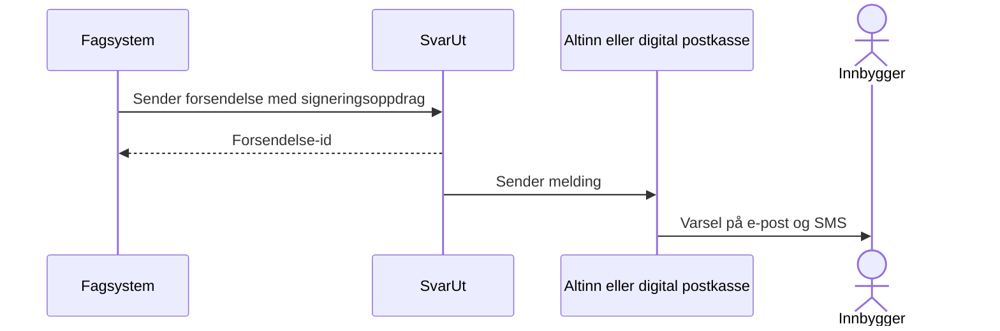
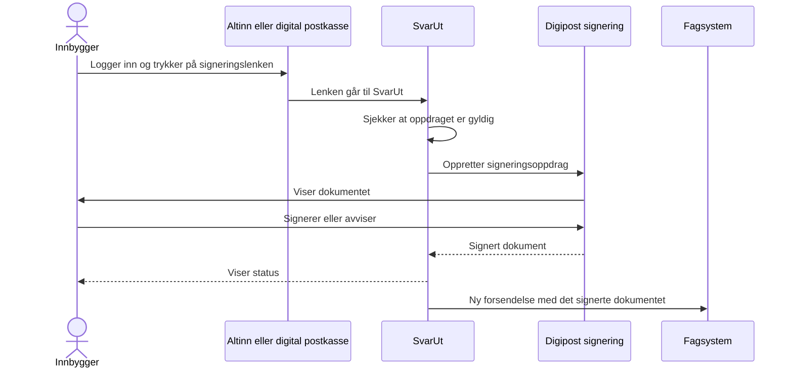

Med signeringstjenesten til Digdir kan en innbygger signere et dokument som kommunen har sendt gjennom SvarUt. Det signerte dokumentet kommer tilbake til kommunen som en ny forsendelse.

## Aktivering

1. Inngå avtale med Digdir om signeringstjenesten. Det krever at dere allerede har avtale om [Digital post til innbyggere (DPI)](https://docs.digdir.no/docs/digitalpostkasse/).
2. Aktiver signeringstjenesten i [Fiks konfigurasjon](https://forvaltning.fiks.ks.no/fiks-konfigurasjon) for hver SvarUt-konto som skal bruke den.

Er tjenesten ikke aktivert på kontoen, blir forsendelsen avvist.

## Sende et signeringsoppdrag

Signering støttes bare for forsendelser til privatpersoner: `POST /v3/kontoer/{kontoId}/forsendelser/person` ([spesifikasjon](https://editor-next.swagger.io/?url=https://developers.fiks.ks.no/api/forsendelse-send-api-v3.json)).

| Felt | Krav |
|---|---|
| `dokumenter[].skalSigneres` | `true` på nøyaktig ett dokument. Dokumentet må være PDF og kan ikke være større enn 10 MiB. |
| `signering.signeringUtloper` | Når oppdraget utløper. Må være minst én dag frem i tid. |
| `signering.signaturType` | `AUTENTISERT_SIGNATUR` eller `AVANSERT_SIGNATUR` |
| `sikkerhetsniva` | Sikkerhetsnivået for innlogging ved signering. `BETYDELIG` er standard. |
| `svarSendesTil` | Organisasjonsnummeret som skal få det signerte dokumentet, med `type: ORGANISASJON`. Kan sløyfes hvis avsenderkontoen har et standard organisasjonsnummer for retur av signerte dokumenter. |

Et signert dokument kan ikke sendes på papir. Derfor må det finnes et organisasjonsnummer å levere det til.

```json
{
  "tittel": "Avtale om skoleskyss",
  "mottaker": { "navn": "Kari Nordmann", "digitalId": "<fødselsnummer>" },
  "svarSendesTil": {
    "type": "ORGANISASJON",
    "navn": "Storevik kommune",
    "digitalId": "<organisasjonsnummer>",
    "adresse": { "adresselinje1": "Rådhusgata 1", "postnummer": "1234", "poststed": "Storevik" }
  },
  "signering": {
    "signeringUtloper": "2026-12-01T12:00:00+01:00",
    "signaturType": "AVANSERT_SIGNATUR"
  },
  "dokumenter": [
    { "filnavn": "avtale.pdf", "mimeType": "application/pdf", "skalSigneres": true }
  ]
}
```

Signeringshistorikken hentes med `GET /v2/forsendelser/{forsendelseId}/signeringshendelser` ([spesifikasjon](https://editor-next.swagger.io/?url=https://developers.fiks.ks.no/api/forsendelse-hendelser-api-v2.json)).

Signeringsoppdrag kan også lages manuelt i SvarUt-portalen. Der markerer du dokumentet som skal signeres og setter utløpsdato.

## Slik foregår det

### Fra fagsystem til innbygger



Forsendelsen går gjennom vanlig [kanalvalg](/tjenester/svarut/sende/kanalvalg/). Har innbyggeren ikke åpnet meldingen innen lesefristen, går brevet i posten. Innbyggeren kan likevel signere digitalt frem til oppdraget utløper.

### Fra innbygger tilbake til fagsystem



- Signerer innbyggeren, lager SvarUt en ny forsendelse med det signerte dokumentet til organisasjonsnummeret i `svarSendesTil`. Organisasjonen henter den med [SvarInn](/tjenester/svarut/motta/) eller i Altinn.
- Avviser innbyggeren, kan oppdraget ikke signeres senere. Avsender ser det i signeringshistorikken.
- Lukker innbyggeren nettleseren uten å velge, kan hen signere senere, så lenge oppdraget ikke har utløpt.

## SOAP

Signering i SOAP V7 og nyere bruker `sendForsendelse` med feltene `krevNiva4Innlogging`, `svarSendesTil`, `signeringUtloper`, `signaturtype` og `dokumenter/skalSigneres`. SOAP avvikles. Se [Migrering til REST v2/v3](/tjenester/svarut/migrering/).
