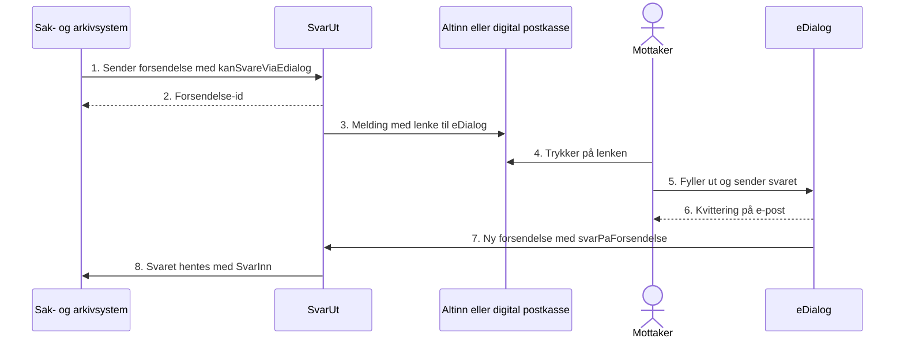

Mottakeren kan svare digitalt på en forsendelse gjennom Fiks eDialog. Svaret kommer tilbake som en ny forsendelse til organisasjonsnummeret avsender har oppgitt. eDialog er en del av Fiks melding og er beskrevet under [eDialog](/tjenester/fiksmelding/edialog).

Dere trenger ikke å ha satt opp mottakere i eDialog for å bruke dette. Svaret sendes fra den opprinnelige SvarUt-kontoen, og det er den som blir fakturert.

## Slik bruker du det

Sett disse feltene når du sender forsendelsen med REST v3:

| Felt | Innhold |
|---|---|
| `kanSvareViaEdialog` | `true` |
| `svarSendesTil` | Organisasjonen svaret skal til, med `type: ORGANISASJON`, gyldig organisasjonsnummer i `digitalId`, navn og adresse |

Når forsendelsen er akseptert og sendt digitalt, får mottakeren en lenke til eDialog i meldingen. Lenken har avsender, mottaker og tittel fylt ut.

I SOAP V6 og nyere heter feltet `svarPaForsendelseLink`.

## Slik foregår det

1. Sak- og arkivsystemet sender forsendelsen med `kanSvareViaEdialog: true` og `svarSendesTil`.
2. Systemet får forsendelse-id-en tilbake.
3. SvarUt sender melding til Altinn eller digital postkasse, med lenke for å svare.
4. Mottakeren trykker på lenken.
5. Mottakeren fyller ut skjemaet i eDialog og sender det.
6. eDialog sender kvittering til mottakeren på e-post.
7. eDialog lager en ny forsendelse til organisasjonen i `svarSendesTil`. Feltet `svarPaForsendelse` er id-en til den opprinnelige forsendelsen.
8. Sak- og arkivsystemet henter svaret med [SvarInn](/tjenester/svarut/motta/), ser at det er et svar og legger det på samme sak.
